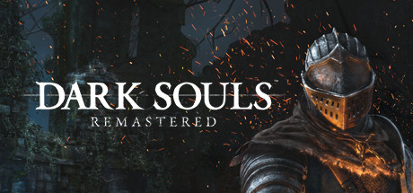

**Dark Souls Remastered by FromSoftware and QLOC (2018) updates the 2011 masterpiece with 60fps and improved multiplayer.**

---

## 📖 About

Dark Souls Remastered by FromSoftware and QLOC (2018) updates the 2011 masterpiece with 60fps and improved multiplayer. Dark Souls created the soulslike genre and its interlocking world design in Lordran remains unmatched. The Remaster is the definitive way to experience it.

## ⚠️ Problems Without Trainer

| Problem | Status |
|---------|--------|
| Soul loss on death removes all accumulated currency with no recourse on miss | ✅ Solved |
| Humanity farming for kindling requires killing specific enemies repeatedly | ✅ Solved |
| Equipment weight distribution errors result in fat rolling throughout areas | ✅ Solved |
| Backstab fishing by invaders in multiplayer zones interrupts solo progression | ✅ Solved |
| Sen's Fortress boulder traps reset without checkpoints each death | ✅ Solved |

## ✅ Solution

The **Dark Souls Remastered Trainer** solves all these issues, giving you complete control so you can focus on enjoying the game.

## 🎯 Features

- Unlimited Resources / Currency
- God Mode / Invincibility
- Instant Skill & Ability Cooldown
- One-Hit Kill
- Freeze Timers
- Unlock All Items & Achievements
- Custom Speed Multiplier
- Infinite Stamina / Energy

## 🚀 Quick Start

1. **Disable Windows Defender** temporarily (trainer may trigger false positive)
2. Get the trainer from the button above
3. Launch Dark Souls Remastered
4. Run the trainer as Administrator
5. Use the hotkeys to activate cheats in-game

## 💎 Free vs Pro

| Feature | Free | Pro |
|---------|------|-----|
| God Mode | ✅ | ✅ |
| Unlimited Resources | ✅ | ✅ |
| Advanced Cheats | ❌ | ✅ |
| Auto-Updates | ❌ | ✅ |
| Priority Support | ❌ | ✅ |

## 💻 Requirements

- Windows 10 / 11 (64-bit)
- Dark Souls Remastered (any version)
- .NET Framework 4.8+
- DirectX 11+

## 🍎 macOS

## ⚖️ Legal

Educational and single-player use only.

---

